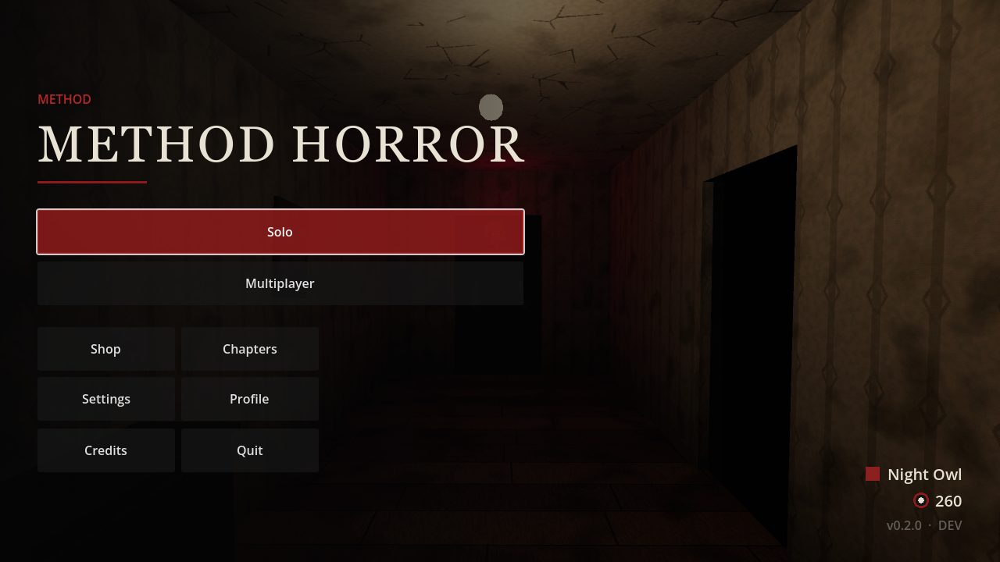
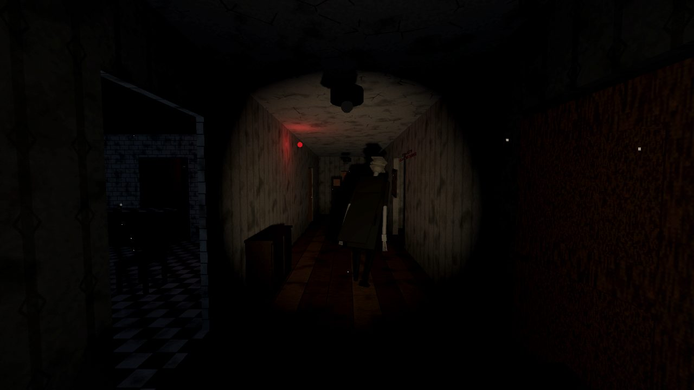
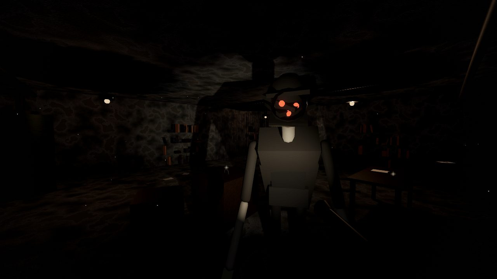
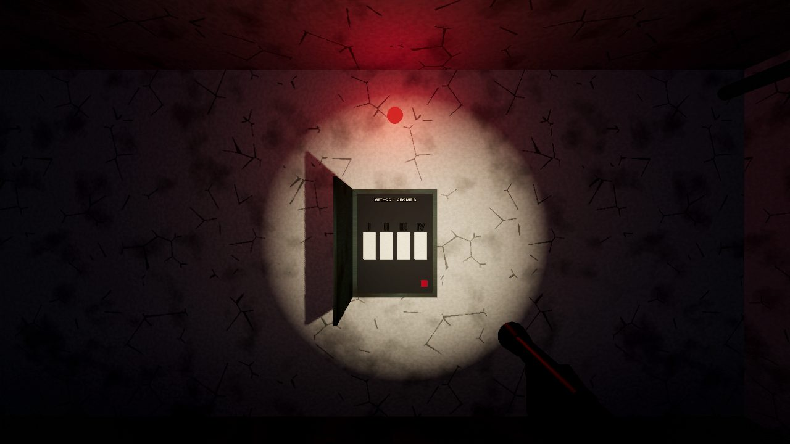
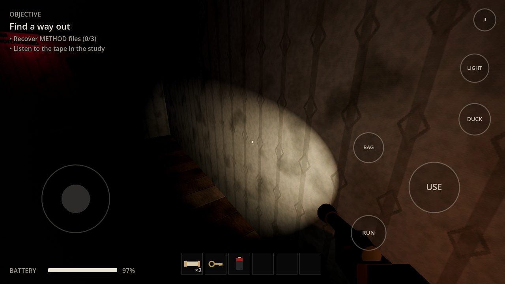

# METHOD HORROR

A first-person cooperative escape-horror game by **METHOD**, built with Godot.
Players investigate abandoned locations tied to METHOD — a vanished research
organization whose experiments altered perception — and escape the
supernatural threats those experiments left behind.

> **Status: Milestone 2 (solo vertical slice).** *The Abandoned House* is fully
> playable solo from the main menu to escape/defeat and results, offline, on
> desktop. Android is configured and exports, but **hardware testing on real
> phones is still pending**. Online/LAN multiplayer is **not built yet**
> (see [Roadmap](#roadmap)). Every claim below is labeled.



| | |
|---|---|
|  |  |
|  |  |

*Screenshots are real renders of the current build (desktop, Mobile renderer).*

## Contents

- [What works today](#what-works-today)
- [Setup](#setup)
- [How to play](#how-to-play)
- [Controls](#controls)
- [Running tests](#running-tests)
- [Exports](#exports)
- [Architecture](#architecture)
- [Known limitations](#known-limitations)
- [Roadmap](#roadmap)
- [Documentation](#documentation)

## What works today

| Area | Status |
|---|---|
| Boot flow: splash → content notice → name → main menu | Implemented, screenshot-verified |
| Solo: map/difficulty select, briefing, gameplay, pause, death/retry, results, rewards | Implemented, covered by automated tests |
| Map 1 *The Abandoned House* (9 rooms, stairwell, basement, garage exit) | Implemented, solvable chain verified for 300 seeds |
| Tutorial (*Orientation Wing*, no enemy) | Implemented, tested |
| Puzzles: fuse circuit + clue, painted-digit keypad code, belt+gear repair, crank timing | Implemented, tested end-to-end |
| The Watcher: sight/hearing/light/crouch, search, chase, telegraphed attack, hiding checks, doors, stuck recovery | Implemented, behavior tests on real geometry |
| First-person controller (walk/sprint/crouch/stamina, flashlight battery, hiding, inventory) | Implemented; desktop-verified, touch hardware-testing pending |
| Touch controls (multitouch joystick + look + buttons, layout editor, left-handed) | Implemented; **not yet tested on a phone** |
| Settings (graphics/audio/controls/gameplay/accessibility), EN/FR | Implemented, persistence tested |
| Saves: versioned, atomic, checksummed, backup recovery, checkpoints | Implemented, tested |
| Local coin economy + cosmetic shop (no real money) | Implemented, tested |
| Online multiplayer, lobby service, room codes, LAN dev mode | **Not built** (Milestone 3); menu shows the reason |
| Maps 2–5 | **Planned**, shown as "Coming later" |
| iOS | Architecture only; **no signed or device-tested build** |

## Setup

Requirements:

- **Godot 4.7.2-stable** exactly ([download](https://godotengine.org/download/archive/4.7.2-stable/)),
  pinned in [`tools/godot-version.txt`](tools/godot-version.txt).
  Official SHA-512 for `Godot_v4.7.2-stable_win64.exe.zip`:
  `83decd58…59993` (full value in [docs/releases.md](docs/releases.md)).
- Git. Python 3 + Pillow only if you regenerate screenshot contact sheets.

```bash
git clone <your-remote> method-horror-game
cd method-horror-game
export GODOT=/path/to/Godot_v4.7.2-stable   # or put `godot` on PATH
./tools/check.sh                            # first import + compile every script
```

Open `game/project.godot` in the Godot editor and press **F5** — or run from a
shell:

```bash
./tools/godot.sh --path game
```

No backend, account or internet connection is needed for solo play.

## How to play

1. Enter a display name (stored only on this device; not an account).
2. **Solo → The Abandoned House → difficulty → Begin.** New players can start
   with **Tutorial**.
3. The front door is chained. Restore power (three fuses — one panel socket is
   scorched; the breaker chart names it), open the basement storage cage (four
   red digits are painted around the house beside symbols; the keypad plate
   shows the order), assemble the drive belt and gear at the garage workbench,
   install it on the garage-door motor, crank-start it in rhythm, and escape
   under the rising door.
4. **The Watcher** arrives after a grace period. It hears footsteps, doors and
   mistakes; it sees farther when you are lit; lamps flicker and keys jingle
   when it is near. Hide in lockers and wardrobes — but not right where it lost
   sight of you.

Difficulty rules are explicit in-game and in [docs/game-design.md](docs/game-design.md#difficulty).

## Controls

| Action | Keyboard / mouse | Controller | Touch |
|---|---|---|---|
| Move | W A S D / arrows | Left stick | Left-side joystick (floating or fixed) |
| Look | Mouse | Right stick | Drag on the right side |
| Interact (hold for some) | E | A | USE |
| Sprint | Shift (hold/toggle) | L3 or LT | RUN |
| Crouch | C / Ctrl (hold/toggle) | B | DUCK |
| Flashlight | F | Y | LIGHT |
| Inventory | Tab / I | X | BAG |
| Pause | Esc / P | Start | II |
| Dev objective inspector | F3 (debug builds only) | — | — |

Keyboard keys are rebindable; touch buttons can be moved, resized, faded and
mirrored for left-handed play.

## Running tests

```bash
./tools/check.sh                                    # compile every script (fails on any error)
./tools/godot.sh --headless --path game -- --test   # 62 unit + integration tests, exit code = result
./tools/godot.sh --headless --path game -- --test --filter=watcher
```

Tests run in isolated `test_*` save files and never touch your profile. A
240 s watchdog fails a hung run. Visual checks (need a GPU):

```bash
./tools/shots.sh /tmp/shots                      # level reference shots + contact sheet
./tools/godot.sh --path game -- --uishots=/tmp/ui  # every UI screen
```

See [docs/testing.md](docs/testing.md) for coverage and the manual QA checklist.

## Exports

Presets: *Windows Desktop*, *Linux*, *Linux Dedicated Server*, *Android*
(`com.method.horror`, configurable). Install the 4.7.2 export templates, then:

```bash
./tools/godot.sh --headless --path game --export-debug "Windows Desktop" ../builds/windows/METHOD_HORROR.exe
./tools/godot.sh --headless --path game --export-debug "Android" ../builds/android/method_horror_debug.apk
```

Android requirements, signing (via `GODOT_ANDROID_KEYSTORE_RELEASE_*`
environment variables — never committed) and device installation steps are in
[docs/releases.md](docs/releases.md).

## Architecture

```
game/
  scripts/core/          autoload services (Settings, Saves, Session) + pure rules:
                         objective graph, reachability solver, inventory, match state
  scripts/audio/         AudioService autoload, procedural synth, music intensity
  scripts/world/         MatchController (authority), MapBase, geometry/prop builders
  scripts/interaction/   entities: doors, fuse panel, keypad, motor, hiding spots…
  scripts/player/        first-person controller + viewmodel
  scripts/ai/            The Watcher (state machine) + procedural rig/animations
  scripts/maps/          per-map builder + rules (house, tutorial)
  scripts/ui/            App root, theme, HUD, touch controls, screens, overlays
  resources/             maps, difficulties, items (.tres)
  localization/          en.json, fr.json
  tests/                 runner, unit and integration tests
  tools/                 asset generators, screenshot tools, parse checker
tools/                   shell helpers (godot launcher, check, shots, import config)
docs/                    design, architecture, security, testing, releases, …
```

Key ideas (details in [docs/architecture.md](docs/architecture.md)):

- **One authoritative rules path.** `MatchController` validates every
  interaction (sender, state, range, line of sight, rate, payload) and mutates
  match state; entities only present it. Solo runs as its own authority, so the
  multiplayer server will run the same code.
- **Data-driven objectives** with a dependency graph and a **reachability
  solver** that proves each seeded item layout is winnable (no key behind its
  own door).
- **No asset dependencies.** Geometry, materials, the Watcher's rig and
  animations, and all audio are generated by in-repo tools.
- Four autoloads only: `Settings`, `Saves`, `AudioService`, `Session`.

## Known limitations

- **No phone has run this build yet.** Touch input, performance targets
  (30 FPS baseline / 60 FPS capable device) and thermals are unmeasured.
- Lighting is fully dynamic (no baked lightmaps yet); occlusion culling is not
  set up. Desktop renders comfortably; mobile cost is unprofiled.
- Placeholder art and audio are procedural: readable and original, not
  photoreal. The tape "voice" is unintelligible by design; subtitles carry it.
- Offline coins are local and tamperable by design (see [docs/economy.md](docs/economy.md)).
- No multiplayer yet; no cloud save or account linking (not promised).

## Roadmap

1. ✅ Foundation — project, theme, generated assets, docs, CI workflows.
2. ✅ Solo vertical slice — *The Abandoned House*, tutorial, menus, saves, settings, economy.
3. ⏳ Authoritative multiplayer: local 2-client validation → guest identity + lobby
   service → private 6-digit rooms → dedicated server allocation → reconnect →
   internet verification.
4. Verified online economy, Maps 2 (*The Black Ward*) and 3 (*Last Train*).
5. Animation/audio/UI refinement, accessibility testing, Android device
   profiling, release signing.
6. Maps 4 (*The Silent School*) and 5 (*METHOD Facility*).

Exact current state and next steps: [docs/continuation.md](docs/continuation.md).

## Documentation

[Game design](docs/game-design.md) · [Architecture](docs/architecture.md) ·
[Networking plan](docs/networking.md) · [Security & threat model](docs/security.md) ·
[Economy](docs/economy.md) · [Performance budgets](docs/performance.md) ·
[Testing & QA](docs/testing.md) · [Releases & exports](docs/releases.md) ·
[Deployment](docs/deployment.md) · [Asset manifest](docs/asset-manifest.md) ·
[Asset replacement](docs/asset-replacement.md) · [Decisions](docs/decisions.md) ·
[Contributing](CONTRIBUTING.md) · [Security policy](SECURITY.md) ·
[Changelog](CHANGELOG.md)

## License

Proprietary — © METHOD, all rights reserved. See [LICENSE.md](LICENSE.md) and
[THIRD_PARTY_NOTICES.md](THIRD_PARTY_NOTICES.md).
